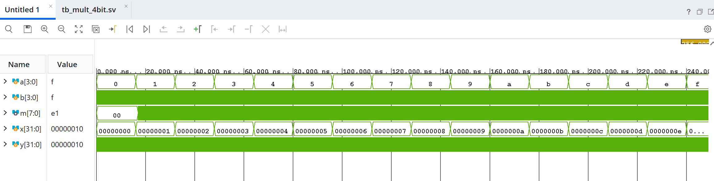
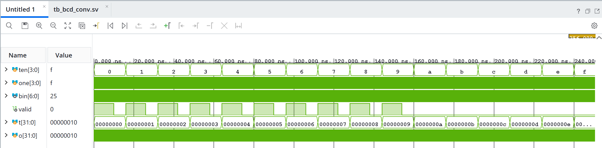

# 실험 후 레포트: 4비트 곱셈기와 BCD-이진수 변환기 (STM32_0 FPGA 교재 실습)

작성일 2026-10-16.

[실험 전 레포트](../pre/01_mult_bcd.md) · [Vivado 빌드 스크립트](../../tools/vivado_build.tcl)

## Vivado GUI 과정과 사전 결과 비교

Vivado 2026.1에서 설계별로 `mult_4bit`, `bcd_conv` 두 프로젝트를 만들었습니다. 타깃 부품은 Spartan-7 `xc7s75fgga484-1`입니다. 프로젝트 생성과 소스 등록은 [tools/vivado_build.tcl](../../tools/vivado_build.tcl)로 수행하고, 생성된 `vivado/<설계>/<설계>.xpr`를 GUI로 열어 시뮬레이션과 보드 다운로드를 진행했습니다.

| 구분 | 4비트 곱셈기 | BCD-이진수 변환기 |
|---|---|---|
| Design Sources | `mult_4bit/mult_4bit.v`, `mult_4bit/multiply_unsigned.v` | `bcd_conv/bcd_conv.v`, `bcd_conv/bcd_to_binary.v` |
| Simulation Sources | `mult_4bit/tb_mult_4bit.sv` | `bcd_conv/tb_bcd_conv.sv` |
| Constraints | [constraints/mult_4bit.xdc](../../constraints/mult_4bit.xdc) | [constraints/bcd_conv.xdc](../../constraints/bcd_conv.xdc) |
| 설계 최상위 | `mult_4bit` | `bcd_conv` |
| 시뮬레이션 최상위 | `tb` | `tb` |

소스 파일은 프로젝트로 복사하지 않고 VS Code 작업 폴더의 원본을 직접 참조하도록 했습니다. 두 테스트벤치 모두 모듈 이름이 `tb`이므로 설계별로 프로젝트를 나누어 한 번에 한 실습씩 실행했습니다.

Flow Navigator의 Run Simulation → Run Behavioral Simulation으로 XSim을 실행한 결과는 다음과 같습니다.

| 설계 | Vivado XSim 로그 | 종료 시각 | VS Code (Icarus Verilog) 사전 결과 |
|---|---|---|---|
| 4비트 곱셈기 | [`PASS multiplier: 256 input pairs`](../../evidence/vivado/mult_4bit_simulation.log) | 256 ns | [`PASS multiplier: 256 input pairs`](../../evidence/vscode/mult_4bit_sim_log.txt), 256 ns |
| BCD 변환기 | [`PASS BCD: 100 valid and 156 invalid inputs`](../../evidence/vivado/bcd_conv_simulation.log) | 256 ns | [`PASS BCD: 100 valid and 156 invalid inputs`](../../evidence/vscode/bcd_conv_sim_log.txt), 256 ns |

두 시뮬레이터에서 PASS 메시지와 종료 시각(`$finish called at time : 256 ns`)이 같아, 256개 입력 조합 전체에 대한 검사 결과가 일치함을 확인했습니다.

### Vivado 파형 해석

- 파형 값은 Vivado 기본 표시 형식인 16진수입니다. `a`가 0부터 f까지 16 ns마다 1씩 증가하고, 각 구간 안에서 `b`가 1 ns마다 0~f로 바뀝니다. 반복문 변수 `x`, `y`(32비트 정수)도 함께 표시되었습니다.
- `a=0` 구간(0~16 ns)에서는 `b`와 관계없이 `m=00`을 유지하고, 이후 구간부터 `m`이 매 ns 바뀝니다.
- 마지막 입력 `a=f`, `b=f`에서 `m=e1`(225)로, 4비트 곱의 최댓값 15 × 15 = 225가 8비트 안에서 넘침 없이 표현됩니다.

- `ten`이 0~9인 구간(0~160 ns)마다 `valid`가 앞의 10 ns 동안 1, 뒤의 6 ns 동안 0이 되는 펄스가 10번 나타납니다. `one`이 0~9일 때만 유효하고 10~15에서는 무효로 판정되기 때문입니다.
- `ten`이 a(10) 이상이 되는 160 ns 이후에는 `valid`가 계속 0입니다.
- 마지막 입력 `ten=f`, `one=f`에서 `bin=25`(16진수, 37)가 표시됩니다. 15 × 10 + 15 = 165는 7비트(최대 127)를 넘어 하위 7비트인 165 − 128 = 37만 남은 값입니다. 이때 `valid=0`이므로 테스트벤치는 `bin` 값을 검사하지 않으며, 범위 밖 입력의 `bin`은 의미 없는 값으로 처리하는 설계 의도와 일치합니다.

## 합성·구현·bit

Run Synthesis → Run Implementation → Generate Bitstream을 실행해 두 설계 모두 `write_bitstream completed successfully`를 확인했습니다. 빌드 로그와 비트스트림을 보관했습니다.

| 설계 | 생성 파일 | SHA-256 | Slice LUT | 레지스터 | 사용 IOB |
|---|---|---|---:|---:|---:|
| 4비트 곱셈기 | [mult_4bit.bit](../../evidence/vivado/mult_4bit.bit) · [빌드 로그](../../evidence/vivado/mult_4bit_build.log) | `aaa2760d…291ddf` | 16 / 48,000 | 0 | 16 / 338 |
| BCD 변환기 | [bcd_conv.bit](../../evidence/vivado/bcd_conv.bit) · [빌드 로그](../../evidence/vivado/bcd_conv_build.log) | `87e7953a…a49176` | 7 / 48,000 | 0 | 16 / 338 |

- **조합회로 확인**: 두 설계 모두 레지스터(FF)를 하나도 사용하지 않고 LUT만으로 구현되어, 클록 없이 입력이 바뀌면 출력이 결정되는 조합회로임을 확인했습니다. 곱셈기는 LUT 16개, BCD 변환기는 LUT 7개를 사용했습니다.
- **핀 배치 확인**: 입력 8비트는 Lab1 4비트 가산기와 같은 스위치 핀(Y1, W3, U2, T1 / W4, W1, V4, U4), 출력 8비트는 Lab3과 같은 LED 핀(L4, M4, M2, N7, M7, M3, M1, N5)에 `LVCMOS33` 규격으로 할당되었습니다.

| XDC 포트 | 곱셈기 | BCD 변환기 | 패키지 핀 | 보드 표시 |
|---|---|---|---|---|
| 입력 [3:0] | `a[3:0]` | `ten[3:0]` | Y1, W3, U2, T1 | 스위치 |
| 입력 [3:0] | `b[3:0]` | `one[3:0]` | W4, W1, V4, U4 | 스위치 |
| 출력 bit 7 | `m[7]` | `valid` | L4 | LED1 |
| 출력 bit 6~0 | `m[6:0]` | `bin[6:0]` | M4, M2, N7, M7, M3, M1, N5 | LED2~LED8 |

### 타이밍 및 경고(Warning) 분석

1. **Timing 38-313 (타이밍 제약 없음) / Place 46-29 (Placer 타이밍 비활성)**:
   * 두 설계에는 클록이 없으므로 `create_clock` 제약을 넣지 않았습니다. 그 결과 타이밍 분석 대상 경로가 없어 발생한 경고이며, 스위치를 손으로 바꾸고 LED를 눈으로 보는 정적 입출력 회로이므로 동작에는 영향이 없습니다.
2. **Power 33-232 (사용자 정의 클록 없음)**:
   * 같은 이유로 전력 추정이 부정확할 수 있다는 안내이며, 기능 검증에는 영향이 없습니다.
3. **DRC 경고 (CFGBVS-1)**:
   * Bank 0의 전압 속성(CFGBVS/CONFIG_VOLTAGE)이 지정되지 않아 발생한 경고입니다. Lab3과 마찬가지로 보드 회로도 기준을 확인하지 않은 전압값을 임의로 넣지 않았으며, 비트스트림이 정상 생성되고 보드에서 동작함을 확인했습니다.

## 보드 기록·촬영 상태

Combo II-DLD S75 보드의 전원과 JTAG 케이블을 연결하고, Hardware Manager의 Auto Connect로 `xc7s75` 디바이스에 각 비트스트림을 차례로 다운로드했습니다. 보드의 LED1이 출력 최상위 비트(L4), LED8이 최하위 비트(N5)이므로 LED1 → LED8 순서로 읽으면 이진수가 그대로 읽힙니다.

### 4비트 곱셈기 (`mult_4bit.bit`)

| 순서 | 입력 a × b | 기대 m (10진수) | 기대 LED1~LED8 | 실측 점등 LED | 판정 | 동작 사진 |
|---|---|---:|---|---|:---:|---|
| 1 | 3 × 5 | 15 | 0000_1111 | LED5, LED6, LED7, LED8 | 일치 | [3 × 5](../../evidence/board/photos/3x5.jpg) |
| 2 | 7 × 9 | 63 | 0011_1111 | LED3 ~ LED8 | 일치 | [7 × 9](../../evidence/board/photos/7x9.jpg) |
| 3 | 15 × 15 | 225 | 1110_0001 | LED1, LED2, LED3, LED8 | 일치 | [15 × 15](../../evidence/board/photos/15x15.jpg) |

[4비트 곱셈기 시연 영상](../../evidence/board/videos/mult_4bit_demo.mp4)

* 15 × 15 = 225에서 최상위 LED1(`m[7]`)이 켜져, 8비트 출력 폭 전체가 사용되고 넘침 없이 표시됨을 확인했습니다.
* 조합회로이므로 스위치를 바꾸는 즉시 LED가 새 곱으로 바뀌며, 리셋이나 버튼 조작이 필요 없습니다.

### BCD-이진수 변환기 (`bcd_conv.bit`)

| 순서 | 입력 | 기대 valid / bin | 기대 LED1~LED8 | 실측 점등 LED | 판정 | 동작 사진 |
|---|---|---|---|---|:---:|---|
| 1 | ten=1, one=2 | 1 / 12 | 1_000_1100 | LED1, LED5, LED6 | 일치 | [12](../../evidence/board/photos/bcd_conv_12.jpg) |
| 2 | ten=5, one=9 | 1 / 59 | 1_011_1011 | LED1, LED3, LED4, LED5, LED7, LED8 | 일치 | [59](../../evidence/board/photos/bcd_conv_59.jpg) |
| 3 | 범위 밖 입력 | 0 / (무효) | LED1 꺼짐 | LED2, LED3, LED6 (LED1 꺼짐) | 일치 | [범위 밖](../../evidence/board/photos/bcd_conv_error.jpg) |

[BCD-이진수 변환기 시연 영상](../../evidence/board/videos/bcd_conv_demo.mp4)

* 유효 입력(12, 59)에서는 `valid` LED1이 켜지고 LED2~LED8에 `bin`이 이진수로 정확히 표시되었습니다.
* 범위 밖 입력에서는 LED1(`valid`)이 꺼졌습니다. 이때 LED2~LED8은 110_0100(100)으로, `ten=10, one=0`처럼 한 자리가 10 이상인 입력을 `ten × 10 + one` 식대로 계산한 값이 그대로 나온 것입니다. 시뮬레이션 160 ns 지점(`ten=10, one=0 → bin=100, valid=0`)과 같은 동작이며, `valid=0`일 때는 `bin`을 사용하지 않는다는 설계 의도대로 동작함을 확인했습니다.

### 사전 계획과 비교

* 실험 전 레포트에서 곱셈기는 3 × 5, 9 × 15, 15 × 15를 확인하기로 했으나 실제로는 9 × 15 대신 7 × 9(63)를 확인했습니다. 135(`1000_0111`)처럼 7비트를 넘는 결과는 15 × 15 = 225에서 최상위 비트 점등으로 대신 확인했습니다.
* BCD 변환기는 계획한 42, 99 대신 12, 59를 확인했으며, 범위 밖 입력에서 `valid`가 꺼지는 것은 계획대로 확인했습니다.

## 결론

부호 없는 4비트 곱셈기(`mult_4bit`)와 `valid` 판정을 추가한 BCD-이진수 변환기(`bcd_conv`)의 256개 입력 조합 자가 검사를 VS Code Icarus Verilog와 Vivado GUI XSim에서 동일하게 PASS(256 ns 종료)로 검증했습니다.

Spartan-7(`xc7s75fgga484-1`) 타깃으로 두 설계를 레지스터 없이 LUT 16개, 7개의 조합회로로 합성·구현하고 비트스트림을 생성했으며, Combo II-DLD S75 보드에서 스위치 입력에 따라 곱셈 결과(15, 63, 225)와 BCD 변환 결과(12, 59) 및 범위 밖 입력의 `valid` 소등이 LED에 기대값대로 표시됨을 실측 검증했습니다.
