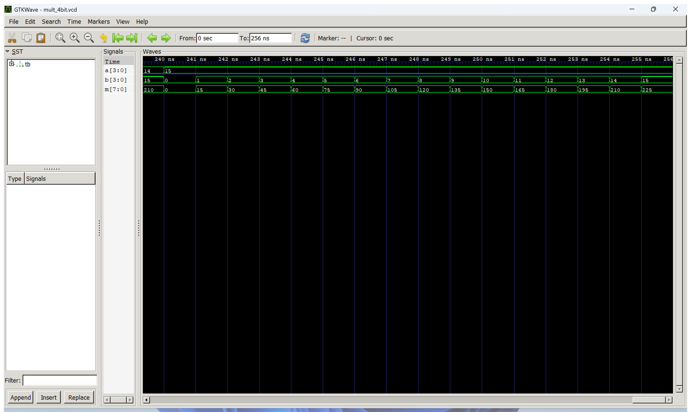
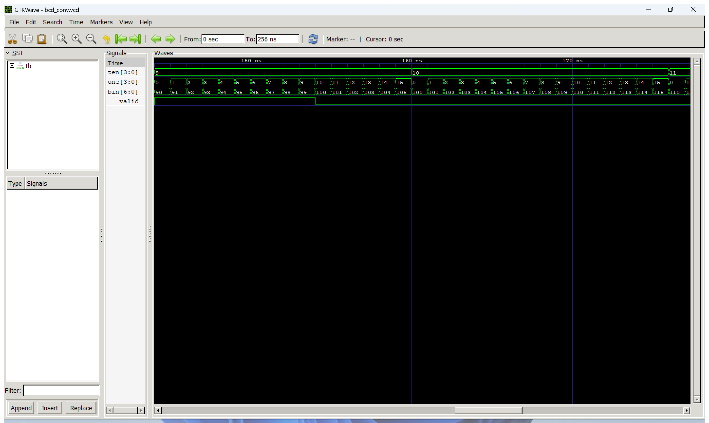

# 실험 전 레포트: 4비트 곱셈기와 BCD-이진수 변환기 (STM32_0 FPGA 교재 실습)

작성일 2026-10-11.

## 1. 목적과 핵심 파라미터 계산

### 실험 목적
STM32_0 주차의 FPGA 교재 실습으로, 클록 없이 입력이 바뀌면 곧바로 출력이 결정되는 두 개의 조합회로를 설계하고 검증한다.
- **4비트 곱셈기(`mult_4bit`)**: 부호 없는 4비트 입력 `a`, `b`를 곱해 8비트 결과 `m`을 출력한다. 실제 곱셈은 폭을 매개변수로 받는 `multiply_unsigned` 모듈이 담당하고, 최상위 모듈은 4비트 입출력만 연결한다.
- **BCD-이진수 변환기(`bcd_conv`)**: 십의 자리 `ten`과 일의 자리 `one`(각각 4비트 BCD)을 받아 7비트 이진수 `bin`으로 변환한다. 원본 예제에 `valid` 출력을 추가해 두 자리가 모두 0~9일 때만 1이 되도록 했다.

보드가 없는 상태이므로 이번 레포트는 Icarus Verilog 시뮬레이션으로 기능을 먼저 확인하고, 보드 시연은 5장의 계획에 따라 실험 시간에 수행한다.

### 핵심 파라미터 계산
1. **곱셈기 출력 비트 폭 (`2*WIDTH`)**:
   - $n$비트 부호 없는 수의 최댓값은 $2^n - 1$이므로 곱의 최댓값은
     $$(2^n - 1)^2 = 2^{2n} - 2^{n+1} + 1 < 2^{2n}$$
   - 따라서 $n$비트 × $n$비트 곱은 $2n$비트로 항상 표현된다. `WIDTH = 4`일 때
     $$15 \times 15 = 225 \le 2^8 - 1 = 255 \;\Rightarrow\; \text{product} : 8\text{ bits}$$
   - 출력을 7비트로 줄이면 최댓값이 127이 되어 $9 \times 15 = 135$부터 넘침이 발생한다(4장 수정 실험에서 확인).

2. **BCD 변환식과 출력 비트 폭**:
   - $\text{bin} = 10 \times \text{ten} + \text{one}$
   - 유효 BCD 범위의 최댓값: $10 \times 9 + 9 = 99$
     $$\lceil \log_2(99 + 1) \rceil = 7\text{ bits}$$
   - 상수 `7'd10`을 7비트로 지정해 곱셈이 7비트 폭에서 계산되도록 한다.

3. **유효성 판정 (`valid`)과 입력 조합 수**:
   - 4비트 입력 하나가 가질 수 있는 값은 0~15이지만 BCD 숫자는 0~9만 유효하다.
   - 전체 조합 $16 \times 16 = 256$개 중 유효 조합은 $10 \times 10 = 100$개, 무효 조합은 $256 - 100 = 156$개이다.
   - 무효 입력에서는 `valid = 0`이며 `bin` 값은 사용하지 않는다(예: `ten=10, one=0`이면 `bin=100`이지만 의미 없는 값).

---

## 2. 파일 구성과 역할

| 경로 | 파일명 | 역할 및 설명 |
|---|---|---|
| `mult_4bit/` | `multiply_unsigned.v` | 매개변수 `WIDTH`를 갖는 부호 없는 곱셈 모듈. `product = a * b` (`2*WIDTH`비트) |
| `mult_4bit/` | `mult_4bit.v` | 설계 최상위(Design Top). `WIDTH=4`로 `multiply_unsigned`를 연결 |
| `mult_4bit/` | `tb_mult_4bit.sv` | 시뮬레이션 최상위(`tb`). 256개 입력 조합을 모두 인가해 자기 검증, VCD 파형 저장 |
| `mult_4bit/` | `mult_4bit.gtkw` | GTKWave 신호 배치(`a`, `b`, `m` 10진수 표시) |
| `bcd_conv/` | `bcd_to_binary.v` | `ten*10 + one` 변환과 `valid` 판정 |
| `bcd_conv/` | `bcd_conv.v` | 설계 최상위(Design Top). `bcd_to_binary`를 연결 |
| `bcd_conv/` | `tb_bcd_conv.sv` | 시뮬레이션 최상위(`tb`). 유효 100개 + 무효 156개 입력 자기 검증, VCD 파형 저장 |
| `bcd_conv/` | `bcd_conv.gtkw` | GTKWave 신호 배치(`ten`, `one`, `bin`, `valid`) |
| 루트 | `run_sim.bat` | `iverilog -g2012` 컴파일 → `vvp` 실행 → (옵션) GTKWave 실행 |
| 루트 | `capture_wave.ps1` | GTKWave 창을 띄워 전체·확대 파형을 `evidence/`에 PNG로 저장 |
| `.vscode/` | `tasks.json` | VS Code `Tasks: Run Task`로 두 시뮬레이션을 실행 |

설계·테스트벤치 코드는 [Glaysia/ece2_474 `docs/FPGA_additional.md`](https://github.com/Glaysia/ece2_474/blob/main/docs/FPGA_additional.md)의 1·2번 실습 코드를 사용했으며, 파형 확인을 위해 각 TB에 `$dumpfile`/`$dumpvars` 한 줄만 추가했다.

---

## 3. 테스트벤치 자극과 기대 결과

두 TB 모두 이중 `for` 반복문으로 4비트 입력 두 개의 모든 조합(0~15 × 0~15)을 1 ns 간격으로 인가하고, 1 ns 뒤 출력이 기대값과 다르면 `$fatal`로 즉시 중단한다. 총 256 ns 후 `PASS` 메시지를 출력하며, 1000 ns 안에 끝나지 않으면 `timeout`으로 실패 처리한다.

### 4비트 곱셈기

| 검사 구간 | 인가 자극 | 기대 출력 | 판정 기준 및 검증 의미 |
|:---:|---|---|---|
| 0~16 ns | `a=0`, `b=0~15` | `m=0` | 0을 곱하면 항상 0 |
| 16~32 ns | `a=1`, `b=0~15` | `m=b` | 항등원 확인 |
| 160 ns 부근 | `a=9`, `b=15` | `m=135` | 7비트(127)를 넘는 첫 결과. 출력 폭이 8비트인지 확인 |
| 240~256 ns | `a=15`, `b=0~15` | `m=0, 15, … , 225` | 최댓값 15×15=225까지 넘침 없이 표현 |
| 전체 | 256개 조합 | `m === a*b` | `!==` 비교로 X·Z까지 포함해 검사 |

### BCD-이진수 변환기

| 검사 구간 | 인가 자극 | 기대 `bin` | 기대 `valid` | 판정 기준 및 검증 의미 |
|:---:|---|:---:|:---:|---|
| 0~10 ns | `ten=0`, `one=0~9` | 0~9 | 1 | 일의 자리만 있는 값 |
| 10~16 ns | `ten=0`, `one=10~15` | (검사 안 함) | 0 | 일의 자리 범위 초과 검출 |
| 144~154 ns | `ten=9`, `one=0~9` | 90~99 | 1 | 유효 최댓값 99까지 7비트로 표현 |
| 160~256 ns | `ten=10~15`, `one=0~15` | (검사 안 함) | 0 | 십의 자리 범위 초과 검출 |
| 전체 | 256개 조합 | 유효 100개 일치 | 유효 100 / 무효 156 | `valid`는 모든 조합, `bin`은 유효 조합만 검사 |

---

## 4. 시뮬레이션 결과 및 수정 실험

실행 환경: Windows 11, Icarus Verilog 12.0 (devel), GTKWave, VS Code `Tasks: Run Task` (`run_sim.bat`).

### 정상 시뮬레이션 확인 – 4비트 곱셈기
- **[종료 로그](../../evidence/vscode/mult_4bit_sim_log.txt)**: `PASS multiplier: 256 input pairs`, 종료 시각 `256000 ps (256 ns)`
- **[전체 파형](../../evidence/vscode/mult_4bit_wave_full.png)**, **[확대 파형](../../evidence/vscode/mult_4bit_wave_zoom.png)**:
  - 240 ns에서 `a`가 14 → 15로 바뀌고 `b`가 0부터 1 ns마다 1씩 증가한다.
  - `m`은 0, 15, 30, 45, … , 210, 225로 15씩 증가하며, 255를 넘지 않고 8비트 안에서 정확히 표현됨을 확인했다.
  - 조합회로이므로 입력이 바뀐 시각과 같은 시각에 출력이 바뀐다(클록 지연 없음).

### 정상 시뮬레이션 확인 – BCD-이진수 변환기
- **[종료 로그](../../evidence/vscode/bcd_conv_sim_log.txt)**: `PASS BCD: 100 valid and 156 invalid inputs`, 종료 시각 `256000 ps (256 ns)`
- **[전체 파형](../../evidence/vscode/bcd_conv_wave_full.png)**, **[확대 파형](../../evidence/vscode/bcd_conv_wave_zoom.png)**:
  - 전체 파형에서 `ten=0~9` 구간마다 `valid`가 10 ns 동안 1, 6 ns 동안 0을 반복하고, `ten`이 10 이상이 된 160 ns 이후에는 계속 0이다.
  - `ten=9` 구간에서 `one=0~9`일 때 `bin=90~99`, `valid=1`이며, `one=10`이 되는 154 ns에 `valid`가 0으로 떨어진다.
  - `ten=10`, `one=0`(160 ns)에서 `bin=100`이 출력되지만 `valid=0`이므로 무효 값으로 처리됨을 확인했다.

### 수정 실험 (오류 주입 및 복구)
원본 폴더를 건드리지 않도록 임시 사본에서 설계 코드 한 줄씩을 고의로 바꿔, 테스트벤치가 오류를 실제로 검출하는지 확인했다.

| 실험 단계 | 설정 내용 | 기대 동작 | 실제 실행 결과 | 비고 |
|---|---|---|---|---|
| 정상 실행 (곱셈기) | `product` 폭 `[2*WIDTH-1:0]` (8비트) | 256개 조합 통과 | `PASS multiplier: 256 input pairs` (256 ns 종료) | 정상 통과 |
| 고장 주입 1 | `product` 폭을 `[2*WIDTH-2:0]` (7비트)로 축소 | 128 이상인 첫 곱(9×15=135)에서 넘침 | 컴파일 경고 `Port 3 (product) ... expects 7 bits, got 8` 후 `FATAL: multiply a=9 b=15 m=7` (160 ns) | 135 mod 128 = 7. 출력 폭 계산의 필요성 확인 |
| 정상 실행 (BCD) | `ten * 7'd10 + one` | 유효 100개 일치 | `PASS BCD: 100 valid and 156 invalid inputs` (256 ns 종료) | 정상 통과 |
| 고장 주입 2 | 자리 가중치를 `7'd8`로 변경 | `ten=1, one=0`에서 10 대신 8 출력 | `FATAL: BCD value` (17 ns, `ten=1, one=0`) | `bin` 값 검사 동작 확인 |
| 고장 주입 3 | `valid` 조건을 `one <= 10`으로 변경 | `ten=0, one=10`에서 `valid=1`로 잘못 판정 | `FATAL: BCD valid` (11 ns, `ten=0, one=10`) | 경계값(9/10) 검사 동작 확인 |
| 원복 복구 | 원본 코드 사용 | 두 실습 모두 통과 | 두 `PASS` 메시지 재확인 | 정상 확인 |

---

## 5. 보드 실험 계획 및 관찰 항목

### 하드웨어 환경
- **장비**: Combo II-DLD (Spartan-7 `xc7s75fgga484-1`)
- **설계 최상위 모듈**: `mult_4bit` / `bcd_conv` (보드에 올릴 때는 `tb_*.sv`를 제외)
- **입출력 연결**: 두 설계 모두 클록·리셋이 없는 조합회로이다. 입력(`a`, `b` 또는 `ten`, `one`) 8비트는 DIP 스위치, 출력(`m` 8비트 또는 `bin` 7비트 + `valid`)은 LED 8개에 연결한다. 실습 자료에 XDC가 포함되지 않으므로 핀 번호는 교재와 장비 핀맵을 보고 실험 시간에 지정한다.

### 보드 관찰 절차
1. **곱셈기**: Vivado에서 `mult_4bit`를 최상위로 합성·구현하고 비트스트림을 다운로드한다.
2. 스위치로 `a=0`을 두고 `b`를 바꿔 LED가 모두 꺼져 있는지 확인한다.
3. `a=3, b=5` → `m=15` (`0000_1111`), `a=9, b=15` → `m=135` (`1000_0111`), `a=15, b=15` → `m=225` (`1110_0001`)가 LED에 이진수로 표시되는지 확인한다. 특히 135와 225에서 최상위 LED(`m[7]`)가 켜지는지 본다.
4. **BCD 변환기**: `bcd_conv`를 최상위로 바꿔 다시 다운로드한다.
5. `ten=4, one=2` → `bin=42` (`010_1010`), `ten=9, one=9` → `bin=99` (`110_0011`)이고 `valid` LED가 켜지는지 확인한다.
6. `one` 또는 `ten`에 10 이상(`1010`)을 넣었을 때 `valid` LED가 꺼지는지 확인하고, 각 경우를 사진·영상으로 기록한다.
